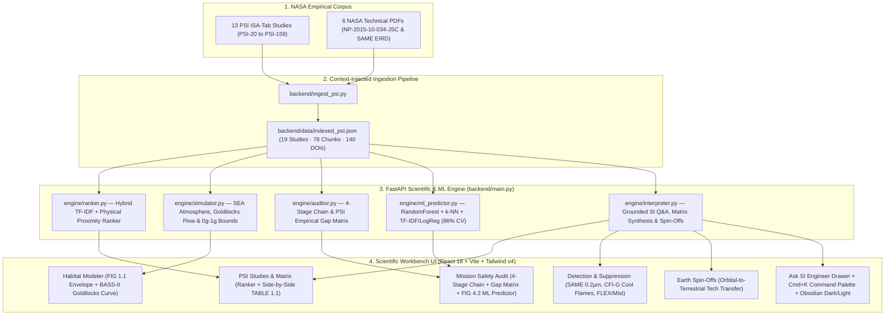

# IGNIS-PSI — Microgravity Combustion & Exploration Fire Safety Intelligence

Built for the **2026 NASA Space Apps Challenge ("Flame in Freefall")**.

**IGNIS-PSI** is a scientific intelligence, predictive modeling, and mission safety auditing workbench for NASA's Physical Sciences Informatics (**PSI**) microgravity combustion corpus. It ingests **19 real NASA investigations** (**13 official PSI ISA-Tab datasets** + **6 NASA technical PDF studies**) into **78 Context-Injected chunks** and **140 peer-reviewed DOIs**, transforming fragmented orbital fire-safety data into ranked comparisons, exploration-atmosphere models, empirical gap audits, and **real Scikit-Learn ML predictions**.

---

## System Architecture



---

## Key Features & What Each Part Does

### Frontend Scientific Workbench (`frontend/src/`)

| Module | File | What It Does |
| :--- | :--- | :--- |
| **App Shell & Telemetry Header** | `App.jsx` | Sticky live telemetry pill (`% O₂ / psia / cm/s / g`) with one-click **Grab**, **Obsidian Dark / Studio Light** theme toggle, collapsible workspace sidebar, **Engineer / Researcher / Student** audience lenses, and mission brief export. |
| **Command Palette (`⌘K`)** | `components/CommandPalette.jsx` | Instant keyboard navigation across all 5 tabs, NASA habitat presets (ISS, Lunar SEA, Mars Transit, EVA Suit), and all 19 indexed studies. |
| **1. PSI Studies & Matrix** | `components/RankerTab.jsx` | Ranks all 19 NASA studies by hybrid semantic + physical proximity (`O₂ %`, `psia`, `cm/s`, `g`), filters by Hardware (`CIR`, `MDCA`, `MSG`, `ACME`, `SoFIE`, `SAFFIRE`), Safety Pillar, and Fuel Phase, and renders a 2–3 study **Side-by-Side Comparison Matrix (`TABLE 1.1`)** covering Objectives, Fuels/Dimensions, Within-Study Variables, Sensors, and DOIs. |
| **2. Habitat Modeler** | `components/SimulatorTab.jsx` | Interactive exploration-atmosphere simulator modeling **Earth/ISS (`21% O₂`, `14.7 psia`)**, **Intermediate SEA (`26.5% O₂`, `10.2 psia`)**, **Lunar Habitat/Rover (`34% O₂`, `8.2 psia`)**, **EVA Suit (`100% O₂`, `4.3 psia`)**, and **ACME CFI-G (up to `85% O₂`)**. Plots **FIG 1.1** Flammability Envelope, **BASS-II Goldilocks** low-velocity airflow hazard (`0–40 cm/s`, peak ~`10 cm/s`), and `0g–1g` partial-gravity bounding (`1/6g` Lunar, `3/8g` Martian). |
| **3. Detection & Suppression** | `components/DetectionSuppressionTab.jsx` | Compares **SAME / SAME-R (`0.2 µm`)** vs. ISS ionization (`1.0 µm`) smoke thresholds, **DAFT / DAFT-2** dust-vs-smoke crossover, **FLEX / FLEX-2** CO₂/He/N₂ dilution limits, **CFI / CFI-G** cool-flame reignition hazards, and **STS-107 Water Mist** extinguishment. |
| **4. Mission Safety Audit & ML Predictor** | `components/AuditTab.jsx` | Audits the **4-Stage Fire Safety Chain** (`Ignition → Detection → Suppression → Post-Fire Toxicity`), exposes NASA's **Empirical Coverage & Gap Matrix** (flagging `0 Direct Studies` for Lunar `1/6g` & Martian `3/8g` solid flammability pending `LUCI`/`FM2`), and renders **FIG 4.2** real Scikit-Learn predictions. |
| **5. Earth Spin-Offs** | `components/SpinoffsTab.jsx` | Maps microgravity combustion breakthroughs to terrestrial applications: fine-water-mist extinguishers, ultra-fine `0.2 µm` EV thermal-runaway & smoke detectors, firefighter PPE, and confined-space air scrubbing. |
| **Ask SI Engineer Drawer** | `components/AskDrawer.jsx` | Grounded Q&A assistant returning structured answers with inline `[PSI-XX \| Acronym \| DOI]` citations. |

---

### Backend Scientific & ML Engines (`backend/`)

| Module | What It Does |
| :--- | :--- |
| **`ingest_psi.py`** | Parses NASA ISA-Tab `i_Investigation.txt` files and technical PDFs into `data/indexed_psi.json`, prepending structured context headers (`[Study_ID \| Acronym \| Hardware \| Safety_Pillar \| Fuel_Phase \| O₂ \| Pressure \| Airflow \| Gravity]`) to every chunk. |
| **`engine/ranker.py`** | Computes hybrid relevance scores combining TF-IDF cosine similarity with physical-envelope proximity against the user's active habitat parameters. |
| **`engine/simulator.py`** | Evaluates exploration atmosphere flammability, `pO₂`, BASS-II Goldilocks ventilation regimes, and `0g–1g` bounding envelopes (incorporating ACME E-FIELD ion-forcing proxies). |
| **`engine/auditor.py`** | Evaluates material & atmosphere safety across the 4-stage chain and cross-references the PSI Empirical Coverage & Gap Matrix. |
| **`engine/ml_predictor.py`** | Trains two **non-mocked Scikit-Learn models** directly on the 19 NASA studies & indexed chunks at startup: (1) **`RandomForestClassifier` (120 trees) + `StandardScaler` `NearestNeighbors`** over `(O₂, Pressure, Airflow)` envelopes to predict Safety Pillar, Fuel Phase, Feature Importances, `k-NN` nearest studies, and **4 Future Warning Forecasts** (`goldilocks_upstream`, `elevated_o2_sea`, `cool_flame_reignition`, `aerosol_dust_crossover`); (2) **`TfidfVectorizer` (1–2 n-grams) + balanced `LogisticRegression`** NLP classifier achieving **86% 5-fold Stratified Cross-Validation accuracy** on the NASA corpus (`POST /api/ml/classify`). |
| **`engine/interpreter.py`** | Grounded Q&A synthesis (`google-genai` when configured, with deterministic PSI-cited fallback), multi-study matrix synthesis, and spin-off mapping. |

---

## Tech Stack

- **Frontend**: React `18.3.1`, Vite `6.0.5`, Tailwind CSS `v4.0.0` (`@tailwindcss/vite`), Recharts `2.15.0`, Lucide React `0.468.0`, Inter + Space Grotesk + JetBrains Mono (`tabular-nums`).
- **Backend**: Python 3, FastAPI `0.163.1`, Pydantic `2.14.3`, Uvicorn.
- **Machine Learning & Scientific Computing**: Scikit-Learn `1.9.1` (`RandomForestClassifier`, `TfidfVectorizer`, `LogisticRegression`, `StandardScaler`, `NearestNeighbors`, `StratifiedKFold`), NumPy `2.5.5`.
- **Testing**: Python `unittest` (`backend/tests/test_pipeline.py`), Vite production bundler.

---

## API Endpoints (`backend/main.py`)

- `GET /api/health` — Corpus counts (`19` studies, `78` chunks, `140` DOIs) and engine status.
- `POST /api/rank` — Hybrid TF-IDF + physical proximity study ranking.
- `POST /api/compare` — Side-by-side comparison matrix for 2–3 selected studies.
- `POST /api/simulate` — Exploration atmosphere, Goldilocks flow, and `0g–1g` bounding simulation.
- `POST /api/audit` — 4-stage mission safety audit, PSI gap matrix, and `ml_prediction` payload.
- `POST /api/ml/classify` — Live NLP anomaly/telemetry classification into NASA Fire Safety Pillars.
- `POST /api/ask` — Grounded SI Engineer Q&A with study/DOI citations.
- `GET /api/detection-suppression` & `GET /api/spinoffs` — Structured detection/suppression and Earth spin-off datasets.

---

## Quickstart

### 1. Backend
```bash
cd backend
python3 -m venv .venv
source .venv/bin/activate
pip install -r requirements.txt
cd ..
backend/.venv/bin/python3 -m unittest discover -s backend/tests -v
backend/.venv/bin/uvicorn backend.main:app --host 127.0.0.1 --port 8000
```

### 2. Frontend
```bash
cd frontend
npm install
npm run dev -- --host 127.0.0.1 --port 5173
```

Open `http://127.0.0.1:5173` in your browser. Press **`⌘K`** at any time to jump across tabs, habitat presets, or studies.

---

## Ingested NASA Data Summary

- **13 Official PSI ISA-Tab Investigations**: `PSI-20` (ACME BRE), `PSI-25` (BASS-II), `PSI-39` (CFI / SAME), `PSI-47` (DAFT / DAFT-2), `PSI-60` (SPICE-Analysis / FLEX), `PSI-62` (BASS-FGM / CFI), `PSI-68` (FLEX-2), `PSI-98` (SAFFIRE-I), `PSI-99` (SAFFIRE-II), `PSI-100` (SAFFIRE-III), `PSI-102` (SAME / DAFT-2), `PSI-106` (SLICE), `PSI-159` (ACME CFI-G).
- **6 NASA Technical PDF Studies**: `PDF-EFIELD` (ACME E-FIELD Flames), `PDF-MIST` (Water Mist Extinguisher STS-107), `PDF-SAMER` (SAME / SAME-R), `PDF-FLAME-DESIGN`, `PDF-SFLAME`, `PDF-CLD`.
- **Corpus Totals**: `19` Studies · `78` Context-Injected Chunks · `140` DOIs · `6` Hardware Facilities (`CIR`, `MDCA`, `ACME`, `SoFIE`, `MSG`, `SAFFIRE`).
